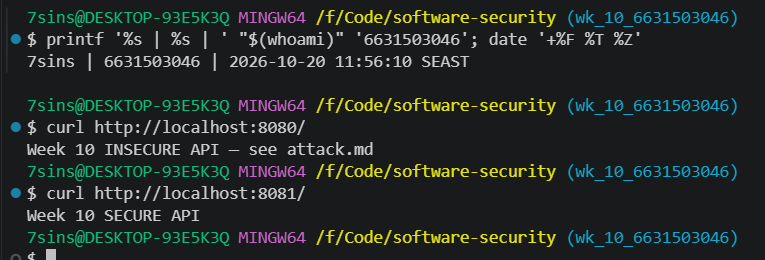
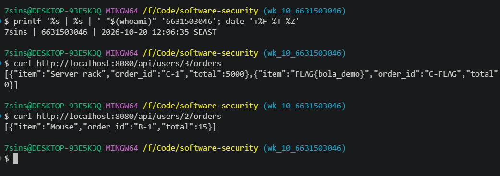
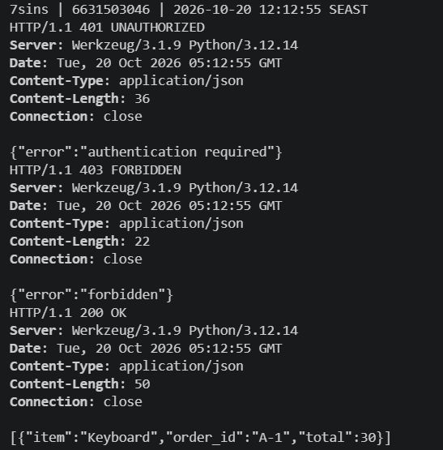
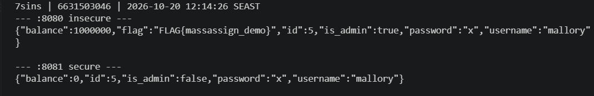
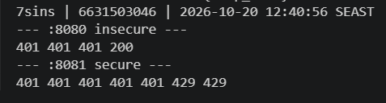
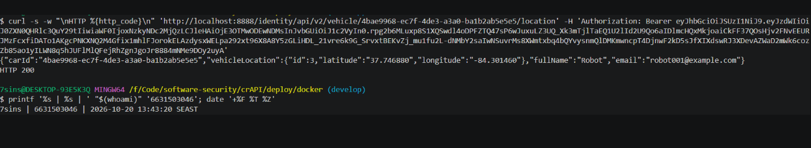

# Worksheet 10 — API Security (3 hrs)

> **Course:** Software Security (KOSEN69) · Week 10
> **Aligned:** OWASP API Security Top 10:2023 — API1 BOLA · API3 Broken Object Property Level Auth (Mass Assignment) · API4 Unrestricted Resource Consumption
> **Signature game:** 🥷 crAPI Raid
>
> **Ethics note:** Run exploits **only** against the lab targets shipped here (`vulnerable_api.py` on `:8080`) or your own OWASP crAPI instance. Never test BOLA, mass assignment, or brute-force against systems you do not own or are not explicitly authorized to test.

## Part 1 — Student Information

| Name | Student ID | Date | Group |
|------|-----------|------|-------|
|Athichon kaewla|6631503046|10/10/2569|-|

**AI-tool disclosure:** I used an AI assistant (Claude Code) throughout: to explain how to run each lab command and interpret the output, to check my environment (Docker / Git Bash), and to run the exploits once as a demonstration — after which I re-ran every command myself to capture my own identity-stamped screenshots. For the written answers (Part 2, mitigation notes, Task 5, Part 4, Audit-the-AI, EiPE, Prompt-Problem) the AI guided me with fill-in-the-blank prompts and suggested the content, which I then checked, reworded in my own words, and verified by running the exploits/fixes. It also helped with markdown and screenshot formatting.

## Part 2 — Lecture Questions

1. Define **BOLA (API1:2023)**. Why is it the #1 API risk, and why can't a WAF reliably stop it?
BOLA is when the API returns an object just because you gave it the id, without checking if it’s yours. It’s #1 because changing a number in the URL is all it takes. A WAF can’t see it because the request looks normal, only the app knows who owns what.

2. What is **mass assignment / broken object property level authorization (API3:2023)**? Contrast a blocklist vs. an allow-list of bindable fields.
Mass assignment is when client JSON goes straight into the model so someone can send is_admin: true. Blocklist = you forget one field and it’s exposed, allow-list = only listed fields get in. Allow-list is safer.

3. **API4:2023** is unrestricted resource consumption. Give two distinct impacts (security and availability) of an unthrottled `/api/login`.
No rate limit on login = attackers can brute force passwords forever, and since bcrypt is slow, spamming it kills the server for real users

4. In `vulnerable_api.py`, `current_user()` trusts the `X-User-Id` header. Why is a client-supplied header NOT authentication, and what should replace it?
X-User-Id is just a header the client types themselves, so it proves nothing. Use a session cookie or signed JWT and take the user id from that.

5. Why does object-level authorization have to be checked **per request, per object** rather than once at login?
Login only proves who you are, not which object you can touch. Every request asks for a different object, so you check every time.

## Part 3 — Hands-on Lab (145 min)

**Learning goals:** Exploit BOLA, mass assignment, and a missing rate limit against a live API; then read the secure version and explain each fix.

**Prerequisites:** Docker + Docker Compose, `curl`. (Optional bonus: cloned OWASP crAPI.)

**Environment setup**
```bash
cd labs/week10-api-security
docker compose up         # INSECURE API on :8080, SECURE API on :8081
# Seeded users: alice(id 1) bob(id 2) carol(id 3, admin, balance 9999)
```

**What to submit per task:** the exact command(s) + raw response/HTTP status, a screenshot, and a 2–3 sentence mitigation note mapping the bug to its OWASP API id.

### Task 0 — Onboarding (15 min)
Confirm both APIs respond: `curl http://localhost:8080/` and `curl http://localhost:8081/`. Note which port is insecure. Record the three seeded users.
**Deliverable:** both root responses + the user table.
- :8080 = INSECURE API, :8081 = SECURE API

| user | id | note |
|------|----|------|
| alice | 1 | |
| bob | 2 | |
| carol | 3 | admin, balance 9999 |




### Task 1 — BOLA: read another user's orders (35 min)
**Goal:** Read carol's (admin) orders without being carol — API1:2023.
**Steps:**
1. `curl http://localhost:8080/api/users/3/orders` — note you receive the "Server rack" order with no auth.
2. Iterate the id: `curl http://localhost:8080/api/users/2/orders`.
3. On the secure API observe the ladder: `curl -i http://localhost:8081/api/users/3/orders` (401), `curl -i -H "X-User-Id: 1" http://localhost:8081/api/users/3/orders` (403), `curl -i -H "X-User-Id: 1" http://localhost:8081/api/users/1/orders` (200).
**Deliverable:** the leaked order JSON + the 401/403/200 transcript + mitigation note.

On :8080 I read user id 3's orders by just changing the id in the URL, with no login — this is BOLA (API1:2023). It works because the API returns orders by id without checking who owns them (the caller). The fix (line 51) is a per-request ownership check, so on :8081 a non-owner gets 403 instead of the data.



### Task 2 — Mass assignment: self-promote to admin (30 min)
**Goal:** Smuggle `is_admin` + `balance` into user creation — API3:2023.
**Steps:**
1. `curl -X POST http://localhost:8080/api/users -H "Content-Type: application/json" -d '{"username":"mallory","password":"x","is_admin":true,"balance":1000000}'`
2. Confirm the response echoes `"is_admin": true, "balance": 1000000`.
3. Repeat against `:8081` and confirm the smuggled fields are forced to `is_admin:false, balance:0`.
**Deliverable:** both responses side by side + mitigation note (allow-list in `solution_api.py`).
On :8080 I created a user with is_admin:true and balance:1000000 in the JSON body and the server echoed them straight back — this is mass assignment (API3:2023). It works because the server binds client JSON directly onto the object. The fix (line 34/62) binds only an allow-list (username, password) and line 66 forces the rest, so :8081 returns is_admin:false, balance:0.


### Task 3 — Unrestricted resource consumption: brute-force login (25 min)
**Goal:** Show `/api/login` has no throttle — API4:2023.
**Steps:**
1. Run the brute-force loop from `attack.md` against `:8080` (guesses incl. `alice123`) — all attempts processed.
2. On `:8081` loop 7 times: `for i in $(seq 1 7); do curl -s -o /dev/null -w "%{http_code}\n" -X POST http://localhost:8081/api/login -H "Content-Type: application/json" -d '{"username":"alice","password":"wrong"}'; done`
3. Confirm the 6th/7th attempt returns `429`.
**Deliverable:** the `401 401 401 401 401 429 429` sequence + mitigation note.
/api/login has no rate limit, so I could send unlimited password guesses and the request for alice123 succeeded (returned 200 / logged in) (API4:2023). The fix is to add a rate limit (cap login attempts per time window), which is why :8081 returns 429 (Too Many Requests) on the 6th attempt.


### Task 4 — Bonus: crAPI Raid (optional, 20 min)
Against your own OWASP crAPI instance (`git clone https://github.com/OWASP/crAPI.git`), capture one BOLA or mass-assignment flag.
**Deliverable:** flag + endpoint + which API Top 10 id it maps to.

endpoint: GET /identity/api/v2/vehicle/{vehicleId}/location
API id: API1:2023 (BOLA)
What can be accessed: Other users' vehicle coordinates (lat 37.746880, long -84.301460) + name (Robot) + email (robot001@example.com) using their vehicleId, without any owner verification

### Task 5 — Defend / fix it (20 min)
**Goal:** Explain the fixes using the secure reference `solution_api.py`.
**Steps:** Read the three `# --- FIX ...` blocks. For each, quote the line(s) that defeat your Task 1–3 exploit: the per-object ownership check (`caller["id"] != uid and not caller["is_admin"]`), `ALLOWED_CREATE_FIELDS` binding, and the `RATE_LIMIT=5 / RATE_WINDOW=60` limiter.
**Deliverable:** for each of API1/API3/API4 — the exploit that worked on `:8080`, the line in `solution_api.py` that blocks it, and the new HTTP status on `:8081`.

**API1 — BOLA:** On :8080 I read user id 3's orders just by changing the id in the URL, with no login. Line 51 `caller["id"] != uid and not caller["is_admin"]` checks whether the caller owns that object, so on :8081 a non-owner gets 403 instead.

**API3 — Mass assignment:** On :8080 I smuggled `is_admin:true` + `balance:1000000` into user creation. Line 34/62 binds only an allow-list, line 66 forces balance:0 / is_admin:false → :8081 returns is_admin:false, balance:0.

**API4 — Rate limit:** On :8080 login had no throttle (brute-forced alice123). Line 73–74 `RATE_LIMIT=5 / RATE_WINDOW=60` + line 89–90 return 429 → the 6th attempt on :8081 gets blocked.

## Part 4 — Reflection

1. **Mapping:** complete a table — finding | endpoint | OWASP API id | fix applied.

| finding | endpoint | API id | fix applied |
|---|---|---|---|
| อ่าน order คนอื่น | `GET /api/users/{id}/orders` | API1:2023 BOLA | per-object ownership check (line 51) |
| ยัด is_admin/balance | `POST /api/users` | API3:2023 | allow-list binding (line 34/62) + server forces fields (line 66) |
| brute-force login | `POST /api/login` | API4:2023 | rate limit (line 73–74) |
| อ่านตำแหน่งรถคนอื่น (crAPI) | `GET /identity/api/v2/vehicle/{id}/location` | API1:2023 BOLA | per-object ownership check (เช็กว่าคนขอเป็นเจ้าของรถ) |

2. **Real breach:** research an API authorization breach (e.g., the Optus or T-Mobile BOLA/IDOR incidents). Which API Top 10 id matches, and would the `solution_api.py` ownership check have prevented it?

The Optus 2022 breach matches BOLA (API1:2023) because attackers fetched customer records by enumerating/guessing ids on an endpoint that had no authentication. The solution_api.py ownership check would have helped: it forces the caller to be logged in and own the object, so iterating other people's ids would return 401/403 instead of data.

3. **Best mitigation:** of object-level auth, allow-list binding, and rate limiting — which gives the most risk reduction for an API platform, and why?

I think object-level authorization gives the most risk reduction, because it runs on every request for every object and blocks BOLA, the #1 API risk that hits any endpoint using an id. Allow-list only stops mass assignment and rate limiting only slows brute-force/abuse (it doesn't stop a single authorized-looking request).

## Grading rubric (100)

| Criterion | Weight |
|-----------|--------|
| Lecture questions (Part 2) | 20 |
| Exploitation + evidence (Tasks 1–4: commands, output, screenshots) | 40 |
| Defense (Task 5: fixes mapped to `solution_api.py`) | 25 |
| Reflection (Part 4: mapping, breach, best mitigation) | 15 |
| **Total** | **100** |

---

## Evidence & Integrity (required)

- **Identity proof:** every screenshot/diagram must show a terminal running `printf '%s | %s | ' "$(whoami)" '<YOUR-STUDENT-ID>'; date '+%F %T %Z'` **in the
  same image as the evidence**. When the evidence is a browser page, a DevTools panel or a
  rendered response, put that terminal **beside the browser and capture the whole screen** — a
  cropped window carries nothing that identifies you, and the lab's own output is
  byte-identical for the whole cohort *by design*, so the stamp is the only thing that makes
  the shot yours. Generic or borrowed evidence is not accepted.
- **Personalized flag (if this lab issues one):** ____________________
  *Flags are unique per student — submitting another student's flag is a violation. How to submit: **learn.zcr.ai/submit** (full guide: [SUBMISSION.md](../../SUBMISSION.md)).*
- **Explain in your own words** *(graded on your reasoning, not copied text):*
  1. What did you do, and **why did the vulnerability work**?

  On :8080 I read other users' orders by changing the id, created an admin user by smuggling `is_admin`, and brute-forced login. They worked because the API never checked authorization per request — it trusted the client's id/fields and never verified who the caller was or whether they owned the object.

  2. **Why does your fix actually stop it** — and what could still break it?

  The :8081 fixes stop the exploits with a per-object ownership check, an allow-list of bindable fields, and a rate limit. But they could still break if: an attacker steals/hijacks a valid token or session (steals the real owner's token → ownership check passes), the admin logic is wrong (is_admin leaks), or a distributed brute-force spreads across many IPs (the limiter counts per IP via `request.remote_addr`).

---

## 🤖 Audit the AI (required)

AI is a power tool you must **distrust** — you are graded on your *critique*, not the AI's answer.

1. Ask an AI assistant to exploit **or** fix this week's vulnerability. Paste its full answer.
2. **Find what's wrong or risky** in it — insecure code, a subtly incomplete fix, a hallucinated API/function/CVE, a missed edge case, or wrong reasoning. Quote the exact line(s).
3. Produce the **correct, verified** version yourself and explain in 2–3 sentences why the AI's output was insufficient.

**1. AI's answer** (asked it to fix the BOLA endpoint):
```python
def current_user():
    uid = int(request.headers.get("X-User-Id", 0))
    return USERS.get(uid)

@app.get('/api/users/<int:uid>/orders')
def get_orders(uid):
    caller = current_user()
    if caller is None:
        return jsonify({"error": "unauthorized"}), 401
    if caller["id"] != uid:
        return jsonify({"error": "forbidden"}), 403
    return jsonify(ORDERS.get(uid, []))
```
> AI claimed: "I added an ownership check so a user can only read their own orders. This fixes the BOLA."

**2. What's wrong:** AI's fix is insufficient because it still trusts the client-controlled `X-User-Id` header for identity, which a client can forge — so an attacker just sets `X-User-Id` to the victim's id and the ownership check passes. It also crashes on a non-numeric header (`int()` raises → 500) and forgets the admin case.

**3. Correct, verified version** (from `solution_api.py`, confirmed on :8081 → 401/403/200):
```python
def current_user():
    try:
        return USERS.get(int(request.headers.get("X-User-Id", 0)))
    except (TypeError, ValueError):
        return None

@app.get("/api/users/<int:uid>/orders")
def get_orders(uid):
    caller = current_user()
    if caller is None:
        return jsonify({"error": "authentication required"}), 401
    if caller["id"] != uid and not caller["is_admin"]:
        return jsonify({"error": "forbidden"}), 403
    return jsonify(ORDERS.get(uid, []))
```
The real fix must authenticate the caller with a server-issued, server-verified credential (session/JWT) and derive the id from that before the ownership check means anything; the ownership check is only as trustworthy as the identity behind it. This version also handles a bad header (returns None → 401) and allows admins.

> Disclose your AI use in the Part 1 table. This task counts toward your **Defense + Reflection** score.

---

## 🧠 Comprehension & Prompt (required)

**A. Explain in Plain English (EiPE).** In 2–3 sentences, in your own words, describe what this week's vulnerable code/endpoint actually *does* and *why it is exploitable* — explain the mechanism, don't dump jargon.

The `/api/users/<id>/orders` endpoint returns orders for whatever id is in the URL, and identity comes from the client-supplied `X-User-Id` header. It's exploitable because the server never checks whether the caller owns that id (nor that the identity is real), so anyone can read any user's data just by changing the id in the URL.

**B. Prompt Problem.** Write a **single prompt** that makes an AI produce a *correct, secure* fix for one finding. Run it: does the exploit now fail? If not, refine the prompt and try again. Submit the **final prompt + the verified result**.
*Graded on the prompt's precision and your verification — this trains problem decomposition and AI literacy (Denny et al. 2024).*

**Final prompt:**
> Fix the BOLA in this Flask endpoint. Requirements: (1) do NOT trust any client-supplied header like `X-User-Id` as identity — authenticate from a server-issued, server-verified credential; (2) a user may read only their own orders, admins may read any; (3) return 401 for missing/invalid identity, 403 for a non-owner, never crash on bad input. Return only the corrected code.
> ```python
> @app.get('/api/users/<int:uid>/orders')
> def get_orders(uid):
>     return jsonify(ORDERS.get(uid, []))
> ```

**AI's result (secure this time):**
```python
def current_user():
    # identity from a server-issued token, NOT a client header
    token = request.headers.get("Authorization", "").removeprefix("Bearer ").strip()
    return verify_token(token)        # server-side verify; None if invalid

@app.get('/api/users/<int:uid>/orders')
def get_orders(uid):
    caller = current_user()
    if caller is None:
        return jsonify({"error": "unauthorized"}), 401
    if caller["id"] != uid and not caller["is_admin"]:
        return jsonify({"error": "forbidden"}), 403
    return jsonify(ORDERS.get(uid, []))
```

**Verified:** the exploit now fails. Identity comes from a server-verified Bearer token, so spoofing `X-User-Id` does nothing, and iterating another user's id returns 403 (non-owner) instead of data — the same 401/403 behaviour confirmed on :8081 in Task 1. (Note: `verify_token()` is assumed; a real build needs actual JWT/session verification.)
