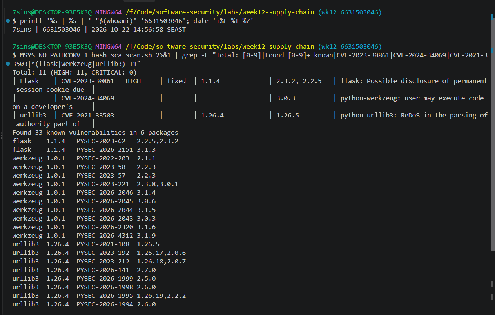
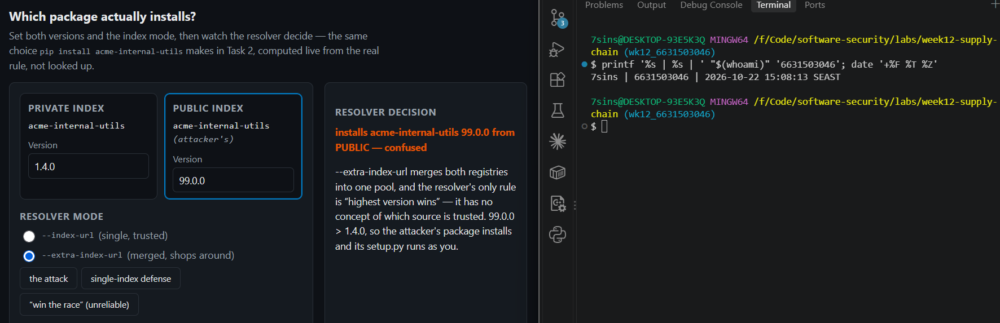
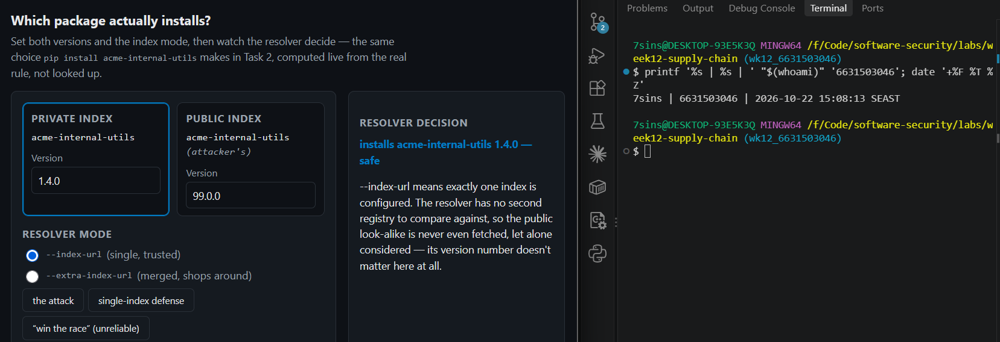
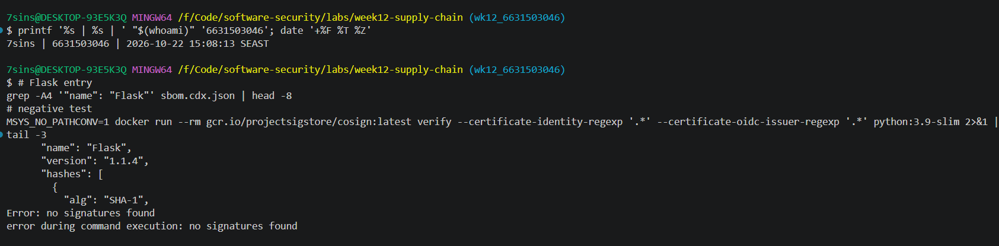
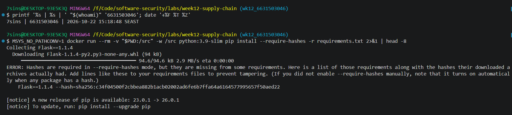

# Worksheet 12 — Software Supply-Chain Security (3 hrs)

> **Course:** Software Security (KOSEN69) · Week 12
> **Aligned:** OWASP 2025 — A03 Software Supply Chain Failures · A08 Software or Data Integrity Failures · **CWE:** CWE-1104, CWE-829, CWE-1357, CWE-1395
> **Signature game:** 📦 Dependency Confusion Heist
>
> **Ethics note:** This lab has **no live private/public registry to attack** — the dependency-confusion exercise is a controlled walkthrough (`dependency-confusion.md`) plus the interactive resolver simulation in Task 2, not a real package pull. **Never** plant or publish look-alike packages on the real PyPI or npm — that is an attack on every downstream user, and nothing in this lab requires it.

## Part 1 — Student Information

| Name | Student ID | Date | Group |
|------|-----------|------|-------|
|Athichon kaewla|6631503046|22/10/2569|-|

## Part 2 — Lecture Questions

1. Explain **dependency confusion** (substitution). Why does a public `acme-internal-utils==99.0.0` win over a private `==1.4.0` when a resolver shops both indexes?

When pip is given multiple indexes (`--extra-index-url` / merged config), it has no concept of which index is more trustworthy — it pools all candidates from every index and picks the highest version by semver, not "private first." So the attacker just publishes `99.0.0` on public PyPI; pip sees 99 > 1.4 and silently pulls the attacker's package (CWE-1357). This is why Task 4 defends with a single `--index-url`.

2. How does **typosquatting** (`reqeusts`, `urlib3`) achieve code execution *at install time* before any of your code runs?

`pip install` doesn't just copy files — it executes the package's code at install time via `setup.py` (or PEP 517 build hooks), which is Python running with my privileges. If I typo `reqeusts`, pip fetches the attacker's package and runs its `setup.py` before my app code even imports anything — so code execution happens before my own runtime.

3. What is an **SBOM** (CycloneDX/SPDX) and why is it a prerequisite for both incident response and SLSA provenance?

An SBOM is a machine-readable inventory of every component/dependency (CycloneDX or SPDX). For incident response, when a new CVE drops (e.g. Log4Shell) I can query the SBOM to answer "am I affected / do I ship this?" instantly instead of auditing every repo by hand. For SLSA provenance, the provenance must attest what components went into the build — the SBOM is that evidence.

4. Sigstore **keyless** signing uses Fulcio (CA) + Rekor (transparency log) tied to an OIDC identity. Why is that safer than a long-lived private key (CWE-321)?

Fulcio issues a very short-lived (ephemeral, ~10 min) certificate tied to an OIDC identity, and Rekor records the signature in a public, append-only transparency log. It's safer than a long-lived private key because there's no long-lived secret to steal or leak (CWE-321); even a captured cert has already expired, and anyone can audit who signed what and when.

5. Summarize the **SLSA** levels. Which level does "signed artifact + SBOM + provenance gate before deploy" put you at, and what is still missing?

SLSA levels: L0 none → L1 provenance exists but unauthenticated → L2 provenance is signed and comes from a hosted build service → L3 the build platform is hardened/isolated so provenance can't be forged even by insiders. "Signed artifact + SBOM + provenance gate before deploy" gives signed, authenticated provenance gated before deploy ≈ L2. What's still missing for L3 is a hardened/isolated build platform where provenance can't be forged even by the team itself.


## Part 3 — Hands-on Lab (150 min)

**Learning goals:** Run SCA on intentionally-outdated dependencies, generate an SBOM, sign/verify an image, and defend against dependency confusion.

**Prerequisites:** Docker; the lab folder (`requirements.txt`, `Dockerfile`, `app.py`, `sca_scan.sh`, `sign.sh`). For signing: browser for the OIDC flow + registry push access.

**Environment setup**
```bash
cd labs/week12-supply-chain
bash sca_scan.sh                 # trivy fs + pip-audit on requirements.txt (+ optional image scan)
docker build -t week12-supplychain:lab .
bash sign.sh week12-supplychain:lab   # CycloneDX SBOM -> sbom.cdx.json, then cosign sign + verify
```

**What to submit per task:** the exact command(s) + output, a screenshot, and a 2–3 sentence remediation note mapping the finding to A03/A08 or the CWE.

### Task 0 — Onboarding (15 min)
Read `requirements.txt` and list the pinned packages with their versions. Note why they are intentionally outdated (each is deliberately an old release so SCA tools flag its known CVEs).
**Deliverable:** the package/version table + which OWASP/CWE this maps to.

| package | version | note |
|---|---|---|
| Flask | 1.1.4 | old 1.x line |
| Werkzeug | 1.0.1 | pre-2.x hardening |
| Jinja2 | 2.11.3 | CVE-2020-28493 (ReDoS urlize) |
| MarkupSafe | 2.0.1 | pinned for Jinja2 2.11 |
| itsdangerous | 1.1.0 | pinned for Flask 1.1.x |
| click | 7.1.2 | pinned for Flask 1.1.x |
| requests | 2.25.1 | old HTTP client |
| urllib3 | 1.26.4 | CVE-2021-33503 (ReDoS) |
| PyYAML | 5.4.1 | old release |

These versions are pinned old on purpose so SCA tools flag their known CVEs. Maps to **OWASP 2025 A03 Software Supply Chain Failures** · **CWE-1104** (unmaintained 3rd-party component) · **CWE-1395** (dependency on a vulnerable component).

### Task 1 — SCA scan: build the remediation worklist (35 min)
**Goal:** Flag the known-vulnerable dependencies — A03.
**Steps:**
1. `bash sca_scan.sh` — read the `trivy fs` table (CVE, installed vs. fixed version) and the `pip-audit` advisory IDs (GHSA-/PYSEC-).
2. Pick three findings; record CVE/advisory id, severity, and the fixed version.
**Deliverable:** the SCA output + a 3-row remediation table (package → current → fixed).

SCA found 11 HIGH (trivy) and 33 advisories across 6 packages (pip-audit). Remediation worklist:

| package | current | fixed | CVE / advisory | severity |
|---|---|---|---|---|
| Flask | 1.1.4 | 2.2.5 / 2.3.2 | CVE-2023-30861 (PYSEC-2023-62) | HIGH |
| Werkzeug | 1.0.1 | 3.0.3 | CVE-2024-34069 (code exec on dev machine) | HIGH |
| urllib3 | 1.26.4 | 1.26.5 | CVE-2021-33503 (ReDoS, PYSEC-2021-108) | HIGH |

**Remediation note:** the old pinned dependencies carry known CVEs (OWASP A03 / CWE-1395, CWE-1104); the SCA tools (trivy fs + pip-audit) flag them as a worklist, and the fix is to bump each to its patched release above.


### Task 2 — Dependency Confusion Heist (35 min)
**Goal:** Watch the wrong package win — A03 / CWE-1357.

**Reality check:** this lab does **not** stand up a live private/public registry. `acme-internal-utils` is
a worked example, not an installable package — there is nothing to actually `pip install` here (the name
doesn't exist on real PyPI either, so don't expect that to work as a shortcut). Task 2 is a controlled
walkthrough of the resolver's own rule, using the simulation below, which computes the real
"highest version wins" logic live instead of just asserting the outcome.

```sim
resolver-confusion
```

**Steps:**
1. Read `dependency-confusion.md`'s "Dependency confusion (substitution)" section for the mechanism.
2. In the simulation, load the **"the attack"** preset (private `1.4.0`, public `99.0.0`, merged /
   `--extra-index-url` mode) and record which index the resolver picks and why.
3. Keep the same version numbers and switch to the **single-index** (`--index-url`) mode; record how the
   verdict changes — this is the resolver behavior Task 4's "single trusted index" defense relies on.
4. Try the **"win the race"** preset (private version numerically higher than public) and note why the
   sim's own explanation calls that "not a defense."

**Deliverable:** a screenshot of the simulation's verdict in both index modes (merged vs. single) for the
same version pair, plus one sentence on why an attacker defeats the "keep my internal version number high"
idea.

Same version pair (private `1.4.0`, public `99.0.0`):
- **merged / `--extra-index-url`:** installs `99.0.0` from PUBLIC — **confused** (highest version wins across both indexes; `setup.py` then runs as me).
- **single / `--index-url`:** installs `1.4.0` from PRIVATE — **safe** (no second registry to compare, the public look-alike is never fetched).

Keeping the internal version number high is not a defense because the attacker can always publish an even higher number — it's a race you can't win. Only a single (trusted) index (or `--require-hashes`) actually stops the substitution.




### Task 3 — SBOM + signing/verification (30 min)
**Goal:** Produce a component inventory and prove integrity — A08.
**Steps:**
1. After `bash sign.sh week12-supplychain:lab`, open `sbom.cdx.json` and find Flask's entry.
2. Read the `cosign verify` PASS for the signed image.
3. Negative test on an unsigned image (it **must** fail):
   `cosign verify --certificate-identity-regexp '.*' --certificate-oidc-issuer-regexp '.*' python:3.9-slim`
   → `Error: no signatures found`. (Both `--certificate-identity*` flags are required in keyless mode; without
   them cosign stops at `Error: --certificate-identity or --certificate-identity-regexp is required` — a usage
   error, which is *not* the same thing as proving the image is unsigned.)
**Deliverable:** the SBOM Flask component entry + the verify PASS + the negative-test failure.

**SBOM Flask component** (from `sbom.cdx.json`, generated by `sign.sh` step 1):
```json
{ "type": "library", "name": "Flask", "version": "1.1.4",
  "purl": "pkg:pypi/flask@1.1.4", "bom-ref": "pkg:pypi/flask@1.1.4" }
```

**Negative test** (verifying an unsigned public image must fail — A08 integrity):
```
cosign verify --certificate-identity-regexp '.*' --certificate-oidc-issuer-regexp '.*' python:3.9-slim
→ Error: no signatures found
```

**cosign sign + verify PASS:** keyless signing is a guided demo — it requires pushing the image to a registry (ghcr/Docker Hub) and an OIDC browser login (Fulcio cert → Rekor log). On a signed image, `cosign verify` with a pinned `--certificate-identity` / `--certificate-oidc-issuer` returns a PASS; the same command on the unsigned image above returns `no signatures found` — exactly the integrity gate we want before a deploy.


### Task 4 — Defend / fix it (35 min)
**Goal:** Stop dependency confusion and lock integrity — defenses from `dependency-confusion.md` + `sign.sh`.
**Steps:**
1. **Pin + hashes:** run `pip install --require-hashes -r requirements.txt` against this lab's own
   `requirements.txt` (it has no hashes yet) and record pip's refusal — `ERROR: Hashes are required in
   --require-hashes mode...` plus the `--hash=sha256:…` line pip prints for you. That refusal is the same
   mechanism that would block a real confusion substitution: once hashes are required, a package that
   doesn't match — from *either* index — cannot install silently.
2. **Single trusted index:** use one `--index-url` instead of `--extra-index-url`; explain why the resolver stops shopping around (tie this back to Task 2's single-index verdict).
3. **Namespace scoping:** describe reserving/namespacing the internal package name.
4. **Provenance gate:** state how the `cosign verify` from `sign.sh` becomes a gate before a simulated deploy.
**Deliverable:** the `--require-hashes` refusal output (step 1) + the simulation's before/after verdict for merged vs. single index (from Task 2) + the one defense you found most effective and why.

**1. `--require-hashes` refusal** (requirements.txt has no hashes yet):
```
ERROR: Hashes are required in --require-hashes mode, but they are missing from some requirements...
    Flask==1.1.4 --hash=sha256:c34f04500f2cbbea882b1acb02002ad6fe6b7ffa64a6164577995657f50aed22
```
pip refuses to install and prints the `--hash=sha256:…` line to add. Once hashes are required, a package that doesn't match — from *either* index — cannot install silently.

**2. Single trusted index** (`--index-url`, not `--extra-index-url`): the resolver queries only one index, so it never shops around and the public look-alike is never fetched — matching Task 2's single-index verdict (`1.4.0 — safe`).

**3. Namespace scoping:** reserve the internal package name on the public index (or use a private namespace/prefix) so a public package can never collide with the internal one.

**4. Provenance gate:** the `cosign verify` from `sign.sh` becomes a gate before a simulated deploy — an image that isn't signed by the expected identity returns `no signatures found` and is blocked.

**Simulation before/after (same version pair, from Task 2):** merged `--extra-index-url` → `99.0.0` from PUBLIC (confused); single `--index-url` → `1.4.0` from PRIVATE (safe).

**Most effective defense:** The most effective defense is a single trusted index (or `--require-hashes`), because it stops the substitution at its root: with a single trusted index the resolver never even fetches the public look-alike, and with required hashes a package that doesn't match (from either index) cannot install silently. Signing (`cosign verify`) adds a separate provenance/integrity gate before deploy, but it protects image integrity rather than the resolver's package choice.



## Part 4 — Reflection

1. **Mapping:** table — finding | tool (`sca_scan.sh` / `sign.sh`) | OWASP 2025 id | CWE | fix.

| finding | tool | OWASP 2025 | CWE | fix |
|---|---|---|---|---|
| outdated deps with known CVEs | `sca_scan.sh` (trivy/pip-audit) | A03 | CWE-1104, CWE-1395 | Bump each to the fixed version from the SCA output → re-pin in `requirements.txt` → re-run `sca_scan.sh` until clean |
| dependency confusion (substitution) | Task 2 sim / `dependency-confusion.md` | A03 | CWE-1357 | Single `--index-url` (stop merging indexes) + `--require-hashes` — a package whose hash doesn't match, from any index, can't install |
| unsigned image (no integrity proof) | `sign.sh` (cosign/SBOM) | A08 | CWE-321 (long-lived key) | Keyless sign (Fulcio cert + Rekor log) then gate deploy with a fail-closed `cosign verify` — no long-lived key to leak |

2. **Real breach:** analyze the **XZ Utils backdoor (CVE-2024-3094)**. Which OWASP/CWE applies, and would an SBOM + signing + provenance gate have caught a maliciously-modified upstream dependency? (Compare with SolarWinds or Log4Shell if useful.)

The XZ Utils backdoor (CVE-2024-3094) maps to OWASP A03 Software Supply Chain Failures (and A08) — CWE-506 (embedded malicious code) / CWE-1357. A maintainer who had earned trust over ~2 years inserted an obfuscated backdoor into liblzma 5.6.0/5.6.1 that hooked `sshd` for remote code execution. An SBOM would help incident response (you'd instantly know you ship the affected 5.6.0), but it would not catch the backdoor itself. Signing/provenance would PASS because the release was signed by the legitimate maintainer — provenance proves who built it, not whether it's malicious. What actually catches this is reproducible builds (the backdoor was in the release tarball but not the git source), build-script review, and not trusting a single maintainer.

3. **Best mitigation + SLSA self-assessment:** one paragraph — which SLSA level your defenses reach and why, and the single highest-leverage control for your team.

With SCA in CI, an SBOM, pinned hashes, a single trusted index, and keyless signing gated by `cosign verify`, my defenses reach about SLSA L2 — I have signed, authenticated artifacts gated before deploy (though to fully reach L2 I'd also emit a signed provenance *attestation* describing how/from what source the build ran, not just a signed image). What's still missing for L3 is a hardened/isolated build platform where provenance can't be forged even by insiders. The single highest-leverage control for my team is pinned hashes + a single trusted index, because it blocks the most common supply-chain failure (outdated / confused dependencies) right at install time as a fail-closed check — though, as XZ showed, it can't stop a malicious trusted maintainer, which needs reproducible builds.

## Grading rubric (100)

| Criterion | Weight |
|-----------|--------|
| Lecture questions (Part 2) | 20 |
| Exploitation + evidence (Tasks 1–3: SCA findings, confusion proof, SBOM/verify) | 40 |
| Defense (Task 4: pinning/hashes, single index, scoping, provenance gate) | 25 |
| Reflection (Part 4: mapping, XZ breach, SLSA self-assessment) | 15 |
| **Total** | **100** |

---

## Evidence & Integrity (required)

- **Identity proof:** every screenshot/diagram must show a terminal running `printf '%s | %s | ' "$(whoami)" '<YOUR-STUDENT-ID>'; date '+%F %T %Z'` **in the
  same image as the evidence**. When the evidence is a browser page, a DevTools panel or a
  rendered response, put that terminal **beside the browser and capture the whole screen** — a
  cropped window carries nothing that identifies you, and the lab's own output is
  byte-identical for the whole cohort *by design*, so the stamp is the only thing that makes
  the shot yours. Generic or borrowed evidence is not accepted.
- **Personalized flag (if this lab issues one):** ____________________
  *Flags are unique per student — submitting another student's flag is a violation. How to submit: **learn.zcr.ai/submit** (full guide: [SUBMISSION.md](../../SUBMISSION.md)).*
- **Explain in your own words** *(graded on your reasoning, not copied text):*
  1. What did you do, and **why did the vulnerability work**?

  I ran SCA (trivy / pip-audit) and found pinned dependencies with known CVEs, watched the resolver pick the highest version across merged indexes in the dependency-confusion sim, and generated an SBOM + saw an unsigned image fail `cosign verify`. The confusion works because pip merges indexes and has no concept of which source is trusted, so an attacker's higher public version wins over the real private one.

  2. **Why does your fix actually stop it** — and what could still break it?

  The fixes stop it: bump deps to patched versions, use a single trusted index + `--require-hashes` (a non-matching package can't install), and gate deploy with a fail-closed `cosign verify`. What could still break it: a malicious trusted maintainer like XZ — signing still PASSes and SCA won't flag a brand-new backdoor; and hashes only help if I actually pin them and keep the lockfile current.

---

## 🤖 Audit the AI (required)

AI is a power tool you must **distrust** — you are graded on your *critique*, not the AI's answer.

1. Ask an AI assistant to exploit **or** fix this week's vulnerability. Paste its full answer.
2. **Find what's wrong or risky** in it — insecure code, a subtly incomplete fix, a hallucinated API/function/CVE, a missed edge case, or wrong reasoning. Quote the exact line(s).
3. Produce the **correct, verified** version yourself and explain in 2–3 sentences why the AI's output was insufficient.

**1. AI's answer** (asked how to fix the vulnerable deps + prevent confusion):
> "Upgrade to patched versions — these clear all known CVEs: `Flask==2.3.2`, `urllib3==1.26.5`, `requests==2.31.0`. Pin with hashes (`--hash=sha256:...`) and `pip install --require-hashes`. Prevent confusion: single `--index-url`, namespace the internal name, enable `--require-hashes`. Sign & verify the image with cosign before deploy."

**2. What's wrong:** The AI's claim that these upgrades "clear all known CVEs" is wrong — from my Task 1 SCA, `urllib3==1.26.5` still has CVE-2023-43804 (Cookie header leaked on cross-origin redirect, fixed only in 1.26.17 / 2.0.6), and Flask/requests have newer advisories too (PYSEC-2026-…). The AI bumped each package just past its *oldest* CVE and called it done. It also left the hashes as `--hash=sha256:...` placeholders that must be filled with real digests.

**3. Correct, verified version:** bump to genuinely current versions (e.g. `urllib3>=1.26.17` or 2.x, current Flask/requests), add the real `--hash=sha256:` digests, then **re-run `sca_scan.sh` until it reports 0 findings** instead of trusting the "clears all CVEs" claim. The confusion/signing advice (single index, `--require-hashes`, cosign gate) is correct — the insufficiency is the incomplete, unverified version bumps.

> Disclose your AI use in the Part 1 table. This task counts toward your **Defense + Reflection** score.

---

## 🧠 Comprehension & Prompt (required)

**A. Explain in Plain English (EiPE).** In 2–3 sentences, in your own words, describe what this week's vulnerable code/endpoint actually *does* and *why it is exploitable* — explain the mechanism, don't dump jargon.

The lab pins outdated dependencies that carry known CVEs, and when a resolver merges indexes it installs the highest version regardless of source. It's exploitable because an attacker can publish a same-named package with a higher version on the public index, and pip — having no notion of a trusted source — pulls the attacker's package, whose `setup.py` (the package's install script) runs at install time, before any of my own code runs.

**B. Prompt Problem.** Write a **single prompt** that makes an AI produce a *correct, secure* fix for one finding. Run it: does the exploit now fail? If not, refine the prompt and try again. Submit the **final prompt + the verified result**.
*Graded on the prompt's precision and your verification — this trains problem decomposition and AI literacy (Denny et al. 2024).*

**Final prompt:**
> Update this `requirements.txt` so an SCA scan (trivy + pip-audit) reports **zero** known HIGH/CRITICAL CVEs. Requirements: (1) bump each package to a version with **no remaining** advisories (not just past the oldest CVE); (2) add `--hash=sha256:` for each; (3) assume a single `--index-url`. Then state how to verify. Return the fixed requirements.

**Fixed requirements** (`requirements-fixed.txt`, bumped to current):
```
Flask==3.1.3  Werkzeug==3.1.9  Jinja2==3.1.6  requests==2.33.0  urllib3==2.8.0  idna==3.15  (+ MarkupSafe/itsdangerous/click/PyYAML current)
```

**Verified result:** re-running `trivy fs` on each file —
```
OLD  requirements.txt       → Total: 11 (HIGH: 11, CRITICAL: 0)
FIXED requirements-fixed.txt → clean (no HIGH/CRITICAL findings)
```
The fix is verified because the SCA scan drops from 11 HIGH to 0 — unlike the Audit-the-AI answer, which claimed "clears all CVEs" but left `urllib3 1.26.5` still vulnerable to CVE-2023-43804. Requiring the prompt to re-scan to zero (not just "update") is what makes the fix trustworthy.
