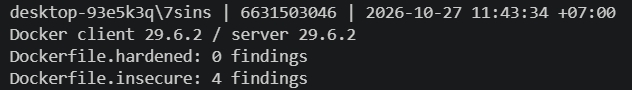

# Worksheet 13 — Cloud & Container Security (4 hrs)

> **Course:** Software Security (KOSEN69) · Week 13
> **Aligned to:** OWASP 2025 **A02 Security Misconfiguration** · **CWE-732** (incorrect permission assignment), **CWE-16** (configuration), **CWE-526** (secret exposed through an environment variable), plus CWE-798 (hard-coded credential — OWASP files this under **A07**), CWE-250, CWE-538, CWE-269, CWE-1104
> **Signature game:** 🔍 *Misconfig Hunt* (CloudGoat-style) — each misconfig you find **and** fix = a flag.

> ⚠️ **Ethics note:** All artifacts here are deliberately broken for teaching and are marked *"Sandbox/teaching only; for authorized lab use."* Scan, exploit, and harden **only** these lab files (or systems you own / are authorized to test). Never point Trivy or these techniques at third-party cloud accounts or images without written permission.

---

## Part 1 — Student Information

| Name | Student ID | Date | Group |
|------|-----------|------|-------|--------------|
| athichon kaewla | 6631503046 | 27/10/2569 | - |
---

## Part 2 — Lecture Questions

1. The cloud provider secures the infrastructure running S3; I secure my app's bucket and IAM settings. For example, I must prevent public access and grant the app only the S3 permissions it needs.
2. `"Action": "*"` allows every action and `"Resource": "*"` applies it to every resource, violating least privilege. CWE-269 covers improper privilege management; CWE-732 covers incorrect permissions on resources.
3. A shipped image can expose the value through `docker history --no-trunc <image>` or `docker image inspect <image>`. This is CWE-526 (secret in an environment variable), CWE-798 (hard-coded credential), and CWE-200 (information exposure).
4. `python:latest` can point to different image versions over time, making builds unpredictable and potentially introducing unreviewed changes. Pinning an `@sha256:` digest selects an immutable image; update the digest deliberately when refreshing the base.
5. Distroless removes a shell, package manager, and many general-purpose tools found in `python:3.11-slim`. This reduces available components and post-exploitation tools, but does not by itself prevent RCE or container escape.

---

## Part 3 — Hands-on Lab (180 min)

**Learning goals:** find cloud/container misconfigurations with Trivy, map each to a CWE, and rebuild the IAM policy + Dockerfile to least privilege / hardened so the findings drop.

**Prerequisites:** Docker installed and running; the `week13-cloud-container/` lab folder; internet access to pull `aquasec/trivy:latest`.

### Environment setup (real commands)

```bash
cd labs/week13-cloud-container

# Option A — the provided wrapper (trivy config over the Dockerfiles; IAM JSON is reviewed manually, see Task 2):
bash scan.sh

# Option B — run Trivy directly (MEDIUM is in the filter on purpose: one of the
# three rules Task 1 asks you to cite is rated MEDIUM, and HIGH,CRITICAL hides it):
docker run --rm -v "$PWD:/src" aquasec/trivy:latest config --severity MEDIUM,HIGH,CRITICAL /src

# (Optional) build + CVE-scan the hardened image:
docker build -f Dockerfile.hardened -t week13-hardened:lab .
docker run --rm -v /var/run/docker.sock:/var/run/docker.sock aquasec/trivy:latest image --severity HIGH,CRITICAL week13-hardened:lab
```


**Windows — copy and run this single PowerShell command from any directory.** It prints your identity stamp, checks Docker, and shows a concise Trivy summary:




Save it as `labs/week13-cloud-container/evidence/task0-task4-trivy.png`. The summary includes the baseline (Task 0) and hardened result (Task 4). If the lines do not all fit, maximize the terminal or reduce its font before running the command again. Use the actual terminal output; do not edit or fabricate evidence.

**What to submit per task:** the command(s) you ran + the relevant output (finding count or the specific finding line), a screenshot of the Trivy/terminal result, and a 2–3 sentence mitigation explaining *why* the fix reduces risk (cite the CWE).


### Tasks

- **Task 0 — Onboarding (15 min).** Run the combined PowerShell block above. **Deliverable:** use the single screenshot `evidence/task0-task4-trivy.png` to show Docker works and record the 4-finding insecure baseline. Trivy does not scan standalone IAM JSON.

- **Task 1 — Misconfig Hunt: container image (40 min).**

  | Defect | CWE | Trivy rule/severity |
  |---|---|---|
  | `FROM python:latest` | CWE-1104 / CWE-16 | DS-0001 / MEDIUM |
  | Secret in `ENV` (2 findings) | CWE-526 / CWE-798 / CWE-200 | DS-0031 / CRITICAL |
  | `COPY . .` | CWE-538 | Manual review — no Trivy rule |
  | `chmod -R 777 /app` | CWE-732 | Manual review — no Trivy rule |
  | Runs as root (no `USER`) | CWE-250 | DS-0002 / HIGH |
  | Unpinned `pip install` | CWE-1104 | Manual review — no Trivy rule |

- **Task 2 — Misconfig Hunt: IAM (30 min).**

  | Misconfiguration | CWE | Fix |
  |---|---|---|
  | `"Action": "*"` | CWE-269 | Allow only required actions, such as `s3:GetObject`. |
  | `"Resource": "*"` | CWE-732 | Restrict access to the required bucket and object prefix. |
  | No `Condition` | CWE-732 | Restrict `s3:ListBucket` with an `s3:prefix` condition. |

  If the credentials leak, an attacker could use the granted permissions across a much wider set of actions and resources than the app requires.

- **Task 3 — Secrets & storage (25 min).** `docker history --no-trunc <image>` and `docker image inspect <image>` can reveal secrets baked into image configuration or layers. Inject secrets at runtime using a secrets manager or mounted/orchestrator secret instead. Add `.git`, `.env`, `.env.*`, `*.pem`, `*.key`, and `.aws` to `.dockerignore` to reduce accidental file disclosure (CWE-538).

- **Task 4 — Hardened-Dockerfile + least-priv-IAM defense (50 min).** The same scan and screenshot show **4 findings before and 0 after**; Trivy does not scan the standalone IAM JSON. The hardened Dockerfile pins base images by digest, removes `chmod 777`, uses a build stage and distroless runtime, copies only required files, removes image-baked secrets, and runs as UID/GID 65532. However, `requirements.txt` still uses `Flask>=3.1.3`, so dependencies are not fully pinned; use an exact version and hashes for reproducible installs. The IAM policy limits `s3:GetObject` to `arn:aws:s3:::lab-app-bucket/app/*` and uses an `s3:prefix` condition for listing. At deployment, add `--read-only --cap-drop ALL --security-opt no-new-privileges`.

- **Task 5 — Flag tally (20 min).** **9 flags** (6 container and 3 IAM) if all are found and fixed. The broad IAM policy is the highest risk because leaked credentials could affect far more actions and resources than necessary.

---

## Part 4 — Reflection

1. **Mapping.** `Dockerfile.insecure`, line 11 (`FROM python:latest`) → CWE-1104/CWE-16 → OWASP 2025 A02; fix by pinning the base image digest. Lines 16–17 (secret in `ENV`) → CWE-526/CWE-798/CWE-200 → A02; inject secrets at runtime. `iam-policy-insecure.json`, lines 8–9 (wildcard action/resource) → CWE-269/CWE-732 → A02; restrict actions and resource ARNs.
2. **Real incident.** In the 2019 Capital One breach, an attacker used a server-side request forgery flaw to obtain cloud credentials and access data in S3. Least-privilege IAM could have reduced the data and actions available to those credentials.
3. **Best mitigation.** Least-privilege IAM often gives strong risk reduction for relatively little effort because it limits the impact of leaked credentials. Distroless and non-root reduce container attack surface and privileges; use both controls together.

---

## Grading rubric (100)

| Component | Points | What earns full marks |
|-----------|:------:|-----------------------|
| Part 2 — Lecture questions | 20 | All 5 answered correctly with CWE/A02 reasoning |
| Part 3 — Tasks + evidence | 40 | Tasks 0–5 complete; commands, outputs, and screenshots present |
| Defense (Task 4 hardening) | 25 | Hardened Dockerfile + least-priv IAM shown to reduce findings; per-fix justification |
| Part 4 — Reflection | 15 | Accurate mapping, relevant incident, well-argued best mitigation |

---

## Evidence & Integrity (required)

- **Identity proof:** every screenshot/diagram must show a terminal running `printf '%s | %s | ' "$(whoami)" '<YOUR-STUDENT-ID>'; date '+%F %T %Z'` **in the
  same image as the evidence**. When the evidence is a browser page, a DevTools panel or a
  rendered response, put that terminal **beside the browser and capture the whole screen** — a
  cropped window carries nothing that identifies you, and the lab's own output is
  byte-identical for the whole cohort *by design*, so the stamp is the only thing that makes
  the shot yours. Generic or borrowed evidence is not accepted.
- **Personalized flag (if this lab issues one):** N/A (9 conceptual flags found and fixed in Misconfig Hunt)
  *Flags are unique per student — submitting another student's flag is a violation. How to submit: **learn.zcr.ai/submit** (full guide: [SUBMISSION.md](../../SUBMISSION.md)).*
- **Explain in your own words** *(graded on your reasoning, not copied text):*
  1. What did you do, and **why did the vulnerability work**?
     I identified and remediated critical security misconfigurations in container images and AWS IAM policies using Trivy configuration scanning and manual security review. The vulnerabilities worked because `Dockerfile.insecure` baked plaintext secrets (`API_TOKEN`, `AWS_SECRET_ACCESS_KEY`) directly into `ENV` layers, exposing them through `docker history` and `docker inspect` to anyone with image read access. Furthermore, omitting the `USER` instruction caused the container to run as `root` (UID 0), which along with `chmod -R 777 /app` allowed complete system compromise in the event of an RCE. On the cloud infrastructure side, the IAM policy granted wildcard administrative access (`"Action": "*"`, `"Resource": "*"`) without scoping or condition blocks, giving compromised credentials unlimited blast radius across all AWS resources.
  2. **Why does your fix actually stop it** — and what could still break it?
     The fix replaces the vulnerable setup with a hardened multi-stage build deploying to a distroless runtime (`gcr.io/distroless/python3-debian12`) running as non-root (`USER 65532:65532`). This stops attacks by eliminating interactive shells, package managers, and root privileges entirely, preventing attackers from downloading tools or pivoting. Secrets were removed from the image and injected at runtime, and the IAM policy was rewritten to strictly allow only `s3:GetObject` on the specific ARN prefix and `s3:ListBucket` guarded by an `s3:prefix` condition. What could still break it: `requirements.txt` specifies `Flask>=3.1.3` rather than a strictly locked version with sha256 checksums, which could introduce vulnerabilities via supply chain attacks during automated rebuilds, and runtime security flags (`--read-only`, `--cap-drop ALL`, `--security-opt no-new-privileges`) must be strictly configured upon container deployment.

---

## 🤖 Audit the AI (required)

AI is a power tool you must **distrust** — you are graded on your *critique*, not the AI's answer.

1. **AI answer used:** “The Trivy config scan reports 0 findings for `Dockerfile.hardened`, so the hardened container is secure and reproducible.”
2. **Critique:** The conclusion overstates what the scan proves. Trivy config checks selected configuration rules; it does not prove runtime secret delivery, application behavior, or reproducible Python dependencies. In particular, `requirements.txt` uses `Flask>=3.1.3`, which is not an exact version or hash lock.
3. **Verified correction:** The Trivy scan reports 0 configuration findings for `Dockerfile.hardened`, including no DS-0031 secret finding. This is not a full security or reproducibility guarantee; dependencies should be pinned and hash-locked, and runtime secret injection should be tested separately.

> Disclose your AI use in the Part 1 table. This task counts toward your **Defense + Reflection** score.

---

## 🧠 Comprehension & Prompt (required)

**A. Explain in Plain English (EiPE).** The sample Flask app only returns simple status responses, while its insecure Dockerfile puts credentials into the image and runs the app as root. Anyone who obtains the image may recover the credentials, and a compromise of the app would have more privileges than necessary.

**B. Prompt Problem.** **Final prompt:** “Update this Dockerfile so no credentials are stored in `ENV`, `ARG`, or image layers. Explain how to inject secrets at runtime using an orchestrator secret, preserve non-root execution, and give a Trivy command to verify the image configuration.”

**Verified result:** The Trivy config scan reports 0 findings for `Dockerfile.hardened`, including no DS-0031 secret finding. This verifies scanned configuration only; it does not test runtime secret injection or an app exploit. The sample app has no intentionally vulnerable endpoint to exploit.
*Graded on the prompt's precision and your verification — this trains problem decomposition and AI literacy (Denny et al. 2024).*
