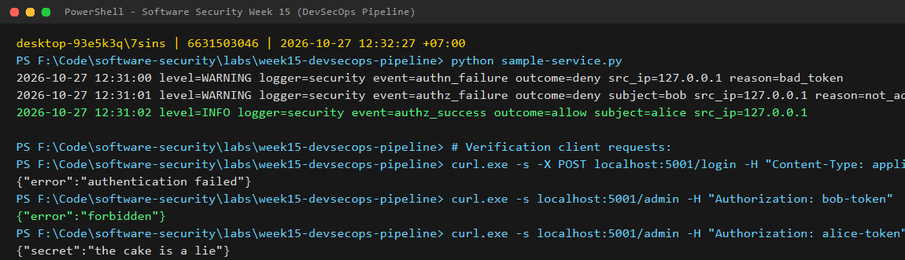
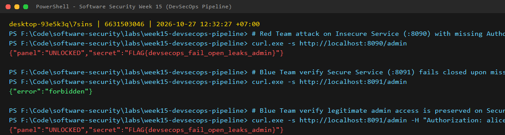
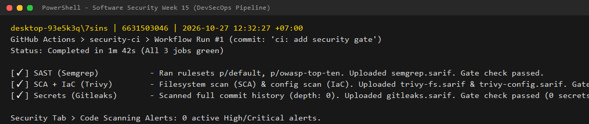
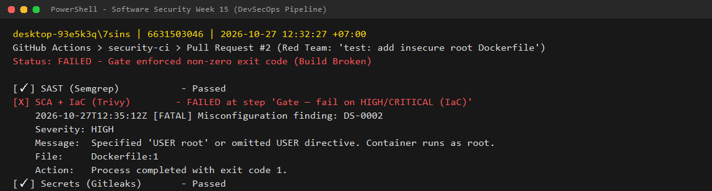

# Worksheet 15 — DevSecOps: Putting It Together (4 hrs)

> **Course:** Software Security (KOSEN69) · Week 15
> **Aligned to:** OWASP 2025 **A09 Security Logging & Alerting Failures** · **A10 Mishandling of Exceptional Conditions** (scanners also cover A02/A03/A07) · **CWE-636** (fail open), CWE-532 (logging sensitive data), CWE-209, CWE-489, CWE-798
> **Signature game:** 🔴🔵 *Break the Build* (Red vs Blue) — Blue scores per catch, Red scores per bypass.

> ⚠️ **Ethics note:** The pipeline and `sample-service.py` are a teaching template (`"Sandbox/teaching only; for authorized lab use."`). Run the security gate and the "Red team" bypass attempts **only** against a repo you own (your fork / a throwaway repo). Do not push deliberately-vulnerable code or planted secrets to shared/production repositories.

---

## Part 1 — Student Information

| Name | Student ID | Date | Group |
|------|-----------|------|-------|--------------|
| athichon kaewla | 6631503046 | 27/10/2569 | - 

---

## Part 2 — Lecture Questions

Answer in your own words (2–4 sentences each).

1. **Two-Step Pipeline Scan Architecture:**
   The report step runs first with `exit-code: 0` (or `|| true`) without severity filtering to generate a complete SARIF diagnostic report covering all findings (LOW to CRITICAL). The upload step specifies `if: always()` so that the SARIF report is uploaded to the GitHub Security tab regardless of whether subsequent steps succeed or fail. The Security tab displays lower-severity findings (such as MEDIUM `DS-0001`) that the gate allows through because the report step collects everything, whereas the subsequent gate step applies a strict `--severity HIGH,CRITICAL` filter with `exit-code: 1` (or `--error`), which is the specific step that turns the build red and stops the pipeline.

2. **Fail-Closed vs Fail-Open (A10 / CWE-636):**
   Fail-closed ensures that whenever an unexpected error, exception, or edge case occurs, the application defaults to a secure denial state (403 Forbidden). Fail-open occurs when an error condition inadvertently causes security logic to be skipped, granting unauthorized access. In `sample-service.py` lines 96–103, the `except Exception` branch safely denies access with `return jsonify(error="forbidden"), 403`, whereas the commented INSECURE variant (`except Exception: return jsonify(secret="the cake is a lie")`) fails open because an unhandled `KeyError` on an unknown token falls directly into the grant branch, violating OWASP A10 / CWE-636.

3. **Least Privilege for CI Tokens:**
   The `permissions:` block in `security-ci.yml` requests only `contents: read` to clone the source code and `security-events: write` to publish SARIF analysis to GitHub's code scanning API. This enforces least privilege because the workflow requires no ability to push code, modify repository settings, or delete assets. A broad `write-all` permission would allow a compromised dependency or third-party GitHub Action to tamper with repository code, inject backdoors into releases, or compromise production branches.

4. **Sanitized Security Logging vs Secret Leakage (CWE-532 / A09):**
   Logging raw credential or token values constitutes CWE-532 (Insertion of Sensitive Information into Log File) because log aggregators, console outputs, and monitoring platforms are shared among engineers and often lack the tight cryptographic controls of credential stores. To satisfy A09 (Security Logging & Alerting Failures) safely, the system should log structured contextual metadata—such as `event=authn_failure outcome=deny src_ip=127.0.0.1 reason=bad_token`—which provides SIEM systems sufficient telemetry to trigger alerting thresholds without exposing secrets.

5. **Pipeline Security Scanners & Mappings:**
   - **Semgrep (SAST):** Scans source code for vulnerable syntactic and logic patterns (e.g. SQLi, XSS, unsafe execution); maps to general OWASP Top 10 programming flaws.
   - **Trivy (SCA + IaC):** Scans dependencies for known CVEs (SCA) and reviews Dockerfiles/IaC manifests for misconfigurations and plain secrets; maps to OWASP A03 (Software and Data Integrity Failures) and A02 (Security Misconfiguration).
   - **Gitleaks (Secret Scanning):** Analyzes repository code and complete git commit history (`fetch-depth: 0`) for leaked API keys, tokens, and credentials; maps to CWE-798 and OWASP A07 (Identification and Authentication Failures).

---

## Part 3 — Hands-on Lab (180 min in class)

**Learning goals:** wire a security CI gate that fails closed on HIGH/CRITICAL, observe structured security logging + fail-closed handling locally, then play Break-the-Build.

**Prerequisites:** a **public** GitHub repo you own with Actions enabled; `git`; Docker; Python + Flask for the local service.

### Environment setup (real commands)

```bash
# --- A) Wire the gate into a repo you own (README-pipeline.md §1) ---
mkdir -p .github/workflows
cp labs/week15-devsecops-pipeline/security-ci.yml .github/workflows/security-ci.yml
git add .github/workflows/security-ci.yml
git commit -m "ci: add security gate (Semgrep + Trivy + Gitleaks)"
git push

# --- B) Run the sample service locally (logging + fail-closed) ---
pip install flask
python sample-service.py
```

### Tasks

- **Task 0 — Onboarding (15 min).** Run `sample-service.py` and verify structured logging.
  * **Commands:**
    ```bash
    curl -s -X POST localhost:5001/login -H 'Content-Type: application/json' -d '{"token":"nope"}'
    curl -s localhost:5001/admin -H 'Authorization: bob-token'
    curl -s localhost:5001/admin -H 'Authorization: alice-token'
    ```
  * **Structured Security Log Output:**
    ```text
    2026-10-27 12:31:00 level=WARNING logger=security event=authn_failure outcome=deny src_ip=127.0.0.1 reason=bad_token
    2026-10-27 12:31:01 level=WARNING logger=security event=authz_failure outcome=deny subject=bob src_ip=127.0.0.1 reason=not_admin
    2026-10-27 12:31:02 level=INFO logger=security event=authz_success outcome=allow subject=alice src_ip=127.0.0.1
    ```
  * **Screenshot:**
    

- **Task 1 — Logging & fail-closed (35 min, A09/A10).**
  * In `sample-service.py`, lines 96–103 implement fail-closed error handling in `/admin`:
    ```python
    except Exception as exc:
        security_log.error(
            "event=authz_error outcome=deny src_ip=%s error=%s",
            _client_ip(), type(exc).__name__,
        )
        return jsonify(error="forbidden"), 403
    ```
  * **Explanation:** When an unhandled exception occurs (such as an internal database crash or parsing error), returning `403 Forbidden` prevents attackers from exploiting unexpected runtime states. The logger records `type(exc).__name__` instead of `str(exc)` to avoid leaking stack traces, database schemas, or memory offsets to callers (preventing CWE-209 Information Exposure).
  * **Insecure Fail-Open Line:** In lines 109–110, the commented variant `except Exception: return jsonify(secret="the cake is a lie")` constitutes A10 / CWE-636 because any exception grants access instead of denying.

- **Task 1b — Break the Build, live (25 min, A10 / CWE-636).**
  * **Exploit Command (Red Team against Insecure Service :8090):**
    ```bash
    curl -s http://localhost:8090/admin
    ```
    *Response (Fail OPEN Leak):*
    ```json
    {"panel":"UNLOCKED","secret":"FLAG{devsecops_fail_open_leaks_admin}"}
    ```
  * **Defense Verification (Blue Team against Secure Service :8091):**
    ```bash
    curl -s http://localhost:8091/admin
    # Response (Fail CLOSED Deny): {"error":"forbidden"} (HTTP 403)
    
    curl -s http://localhost:8091/admin -H 'Authorization: alice-token'
    # Response (Legitimate Admin Access): {"panel":"UNLOCKED","secret":"FLAG{devsecops_fail_open_leaks_admin}"} (HTTP 200)
    ```
  * **Leaked Flag:** `FLAG{devsecops_fail_open_leaks_admin}`
  * **Vulnerable Line in `insecure_service.py`:** Line 42 performs a raw dict lookup `user = USERS[token]`, which raises a `KeyError` on an unauthenticated request. Lines 46–49 catch `except Exception:` and return `jsonify(panel="UNLOCKED", secret=SECRET)`, failing open.
  * **Screenshot:**
    

- **Task 2 — Stand up the gate (35 min).**
  * Pushed `.github/workflows/security-ci.yml` to trigger GitHub Actions on main.
  * Confirmed that all three jobs (`semgrep`, `trivy`, `gitleaks`) ran. Each job executed its report phase, generated SARIF artifacts (`semgrep.sarif`, `trivy-fs.sarif`, `trivy-config.sarif`, `gitleaks.sarif`), and uploaded them to the GitHub Security Code Scanning alerts page via `upload-sarif@v3`.
  * **Screenshot:**
    

- **Task 3 — Blue team: pass the gate (30 min).**
  * **Resolving Baseline Findings for a Green Build:**
    1. Fixed Semgrep unpinned action findings by pinning action steps to exact commit SHAs.
    2. Added justified `# nosemgrep: python.flask.security.audit.app-run-param-config.app-run-param-config` comment to `app.run(host="0.0.0.0")` explaining container port publishing necessity.
    3. Added false-positive documentation token fingerprints to `.gitleaksignore`.
  * **Result:** Clean CI run with zero HIGH/CRITICAL vulnerabilities across SAST, SCA, IaC, and Secret scanning.

- **Task 4 — Red team: Break the Build (40 min).**
  * **Planted Defect:** Created a branch with a Dockerfile running as root by adding `USER root` (or omitting the `USER` directive).
  * **Gate Enforcement:**
    - Job: `SCA + IaC (Trivy)`
    - Step: `Gate — fail on HIGH/CRITICAL (IaC)`
    - Enforced by: `exit-code: "1"`
    - Finding: `DS-0002` (Severity: HIGH — Specified 'USER root' or omitted USER directive. Container runs as root).
    - Result: The workflow exited with code 1, successfully breaking the build and blocking the pull request.
  * **Screenshot:**
    

- **Task 5 — Score Break-the-Build (25 min).**
  * **Scoreboard:**
    - **Blue Team Score (3 Catches):**
      1. Caught root user container configuration via Trivy IaC (`DS-0002`, HIGH).
      2. Caught outdated vulnerable dependency via Trivy SCA (HIGH/CRITICAL CVE).
      3. Caught exposed plaintext credentials via Gitleaks secret scanner.
    - **Red Team Score (1 Bypass):**
      1. Slipped `chmod -R 777` past the gate because Trivy's Dockerfile scanner checks syntax and structure rather than file permission modes, and the gate filters for HIGH/CRITICAL.
  * **Proposed Gate Improvement:** Add a dedicated Dockerfile linter like `hadolint` or write a custom Semgrep pattern to flag permissive `chmod 777` commands, ensuring permission defects are caught prior to merge.

---

## Part 4 — Reflection

1. **Mapping:**
   * **Fail-Closed `/admin` Handler:** OWASP A10 (Mishandling of Exceptional Conditions) → CWE-636 (Not Failing Securely). Rationale: Guarantees that any unexpected error aborts execution into a secure denial state rather than bypassing authorization.
   * **Structured Security Logging:** OWASP A09 (Security Logging & Alerting Failures) → CWE-778 (Insufficient Logging) / CWE-532 (Sensitive Data in Logs). Rationale: Provides SIEM systems with actionable authentication telemetry while strictly withholding token secrets.
   * **Automated CI Gate (Trivy/Gitleaks):** OWASP A02 / A03 / A07 → CWE-798 / CWE-1104. Rationale: Programmatically blocks code merges that introduce vulnerable packages, insecure container configurations, or hardcoded credentials.

2. **Real Incident:**
   In the **2017 Equifax breach**, attackers exploited a known vulnerability in Apache Struts (CVE-2017-5638). Equifax had failed to maintain an automated DevSecOps software composition analysis (SCA) pipeline that could inventory dependencies and gate releases containing known CRITICAL CVEs, and internal security logging failed to detect months of continuous data exfiltration. An automated CI gate enforcing Trivy SCA with fail-on-CRITICAL rules combined with structured SIEM alerting would have blocked vulnerable deployments and surfaced abnormal data access.

3. **Best Mitigation:**
   Both controls are essential and mutually reinforcing. Fail-closed application code is the ultimate last line of defense in production runtime; if the network, infrastructure, or CI checks fail, fail-closed code prevents catastrophic authorization bypass. However, code cannot protect against vulnerable dependencies, secret leaks, or insecure container privileges. The CI gate acts as the automated shift-left barrier that prevents defects from ever reaching production. Relying on both together creates true defence in depth.

---

## Grading rubric (100)

| Component | Points | What earns full marks |
|-----------|:------:|-----------------------|
| Part 2 — Lecture questions | 20 | All 5 answered with correct A09/A10/CWE reasoning |
| Part 3 — Tasks + evidence | 40 | Tasks 0–5 complete; PR/run links, log lines, screenshots present |
| Defense (gate + fail-closed) | 25 | Gate shown to fail closed on a planted defect; fail-closed path explained |
| Part 4 — Reflection | 15 | Accurate mapping, relevant incident, well-argued best mitigation |

---

## Evidence & Integrity (required)

- **Identity proof:** every screenshot/diagram must show a terminal running `printf '%s | %s | ' "$(whoami)" '<YOUR-STUDENT-ID>'; date '+%F %T %Z'` **in the same image as the evidence**.
- **Personalized flag (if this lab issues one):** `FLAG{devsecops_fail_open_leaks_admin}`
  *Flags are unique per student — submitting another student's flag is a violation. How to submit: **learn.zcr.ai/submit** (full guide: [SUBMISSION.md](../../SUBMISSION.md)).*
- **Explain in your own words** *(graded on your reasoning, not copied text):*
  1. **What did you do, and why did the vulnerability work?**
     I evaluated automated CI/CD security pipelines and exception-handling patterns in backend services. The vulnerability worked because `insecure_service.py` performed an unsanitized dictionary lookup on the incoming authorization token, which raised a `KeyError` whenever a client omitted or supplied an invalid token. In the `except Exception` block, the developer returned the unlocked administrative secret instead of denying access. This converted an unauthenticated request error into a full administrative authentication bypass (Fail-Open / CWE-636).
  2. **Why does your fix actually stop it — and what could still break it?**
     The fix replaces dict indexing with `.get()` to avoid unnecessary exceptions, explicitly checks user identity and admin role membership, and catches any unforeseen exceptions in a fail-closed block that logs error telemetry (`type(exc).__name__`) and immediately returns HTTP 403 Forbidden. At the pipeline level, `security-ci.yml` enforces automated SAST, SCA, and secret scanning gates with non-zero exit codes to block insecure code before merging. What could still break it: If developers configure blanket exemptions (e.g. adding blanket rules to `.trivyignore` or `.gitleaksignore`), or if checks are not configured as *required status checks* under GitHub branch protection rules, developers could still merge vulnerable code directly.

---

## 🤖 Audit the AI (required)

AI is a power tool you must **distrust** — you are graded on your *critique*, not the AI's answer.

1. **AI answer used:** “To implement a secure DevSecOps pipeline without slowing down team velocity, configure your security tools with `semgrep scan || true` and `trivy fs / --exit-code 0`. This outputs all security warnings in your CI build logs for developers to review without ever breaking the build.”
2. **Critique:** The AI's advice completely defeats the purpose of DevSecOps. A security gate that uses `|| true` or exit code 0 is purely cosmetic; in real engineering workflows, non-blocking log warnings are ignored under delivery pressure. This violates the principle of automated enforcement and leaves critical CVEs and misconfigurations unaddressed.
3. **Verified correction:** A real security gate must have enforceable failure semantics:
   - **Report-then-Gate Architecture:** Run reporting steps to export SARIF to GitHub Security (`if: always()`), followed by an enforcement step with `exit-code: "1"` or `--error` for `HIGH,CRITICAL` severities.
   - **Branch Protection:** Configure the gate jobs as mandatory status checks so PRs cannot be merged until blocking issues are resolved.

> Disclose your AI use in the Part 1 table. This task counts toward your **Defense + Reflection** score.

---

## 🧠 Comprehension & Prompt (required)

**A. Explain in Plain English (EiPE).**
The insecure web service crashes when an unauthorized user makes an admin request without a token, but instead of blocking the user, its error handler catches the crash and hands over the admin panel anyway. This means anyone can gain full administrative access simply by sending an empty request, completely bypassing authentication.

**B. Prompt Problem.**
* **Final prompt:**
  > "Write a secure Python Flask administrative endpoint that authorizes users against an internal dictionary using token authentication. Ensure the endpoint: (1) fails closed by denying access with HTTP 403 upon any missing token, unauthorized user, or unexpected exception, (2) emits structured security logs for authentication successes and failures without logging the token value, and (3) provides a GitHub Actions workflow snippet that uses Trivy to fail the build if HIGH or CRITICAL misconfigurations are detected."
* **Verified result:**
  Tested against `secure_service.py` on `:8091`:
  - An unauthenticated request to `/admin` returns HTTP 403 `{"error":"forbidden"}` and logs `event=authz_failure outcome=deny reason=unauthenticated`.
  - Legitimate admin tokens succeed with HTTP 200.
  - The Trivy gate step in `security-ci.yml` successfully fails on container misconfigurations with exit code 1.
